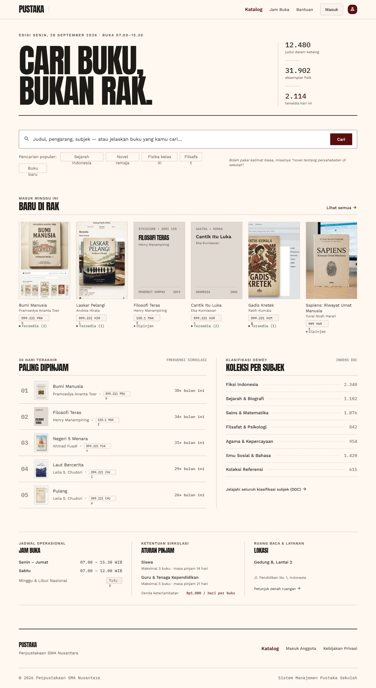
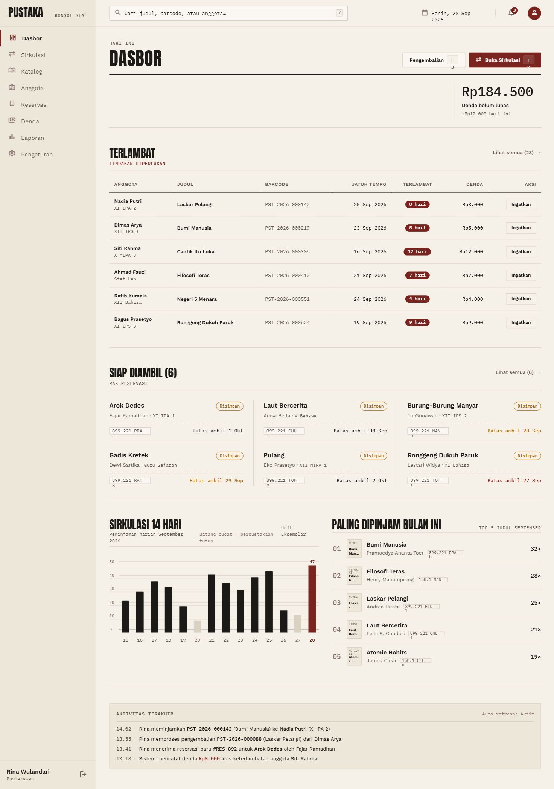
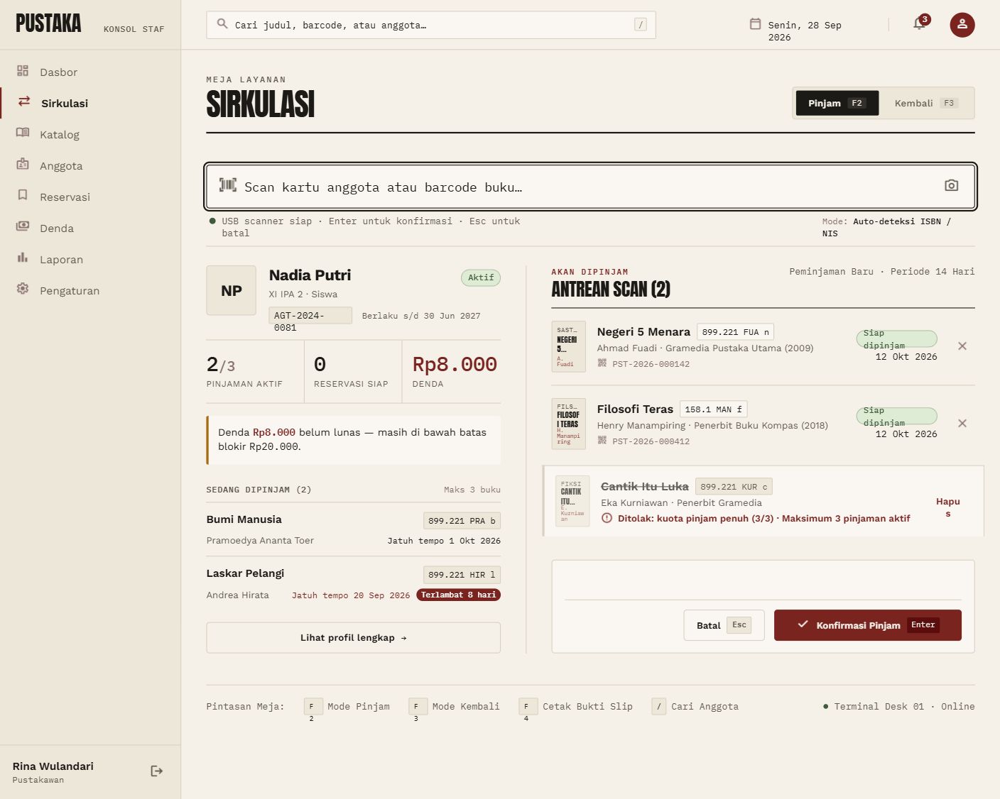
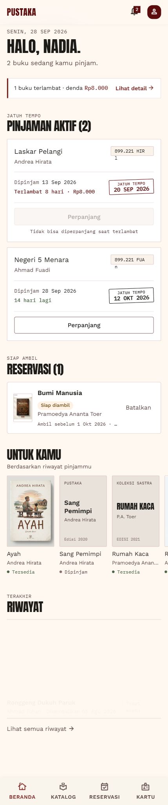
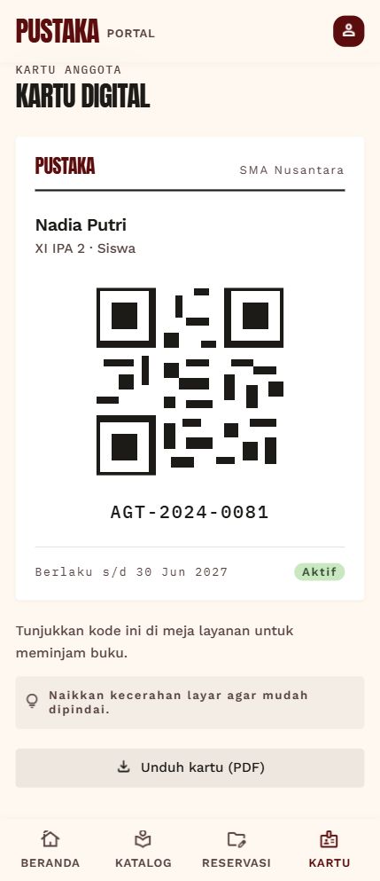
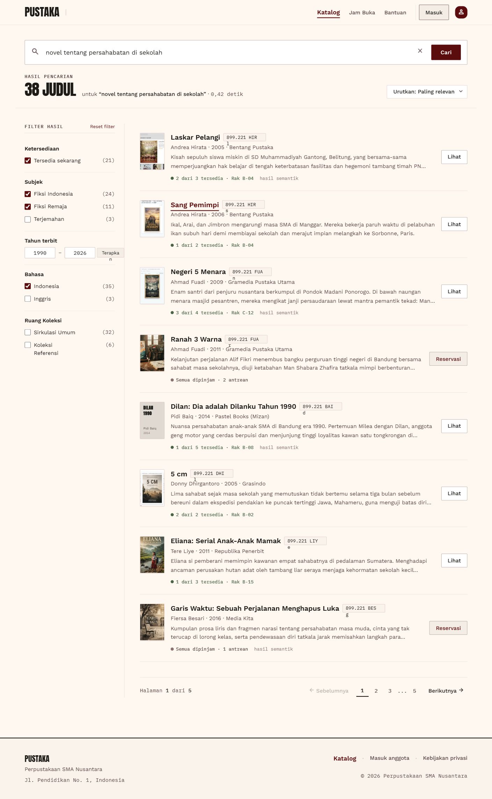
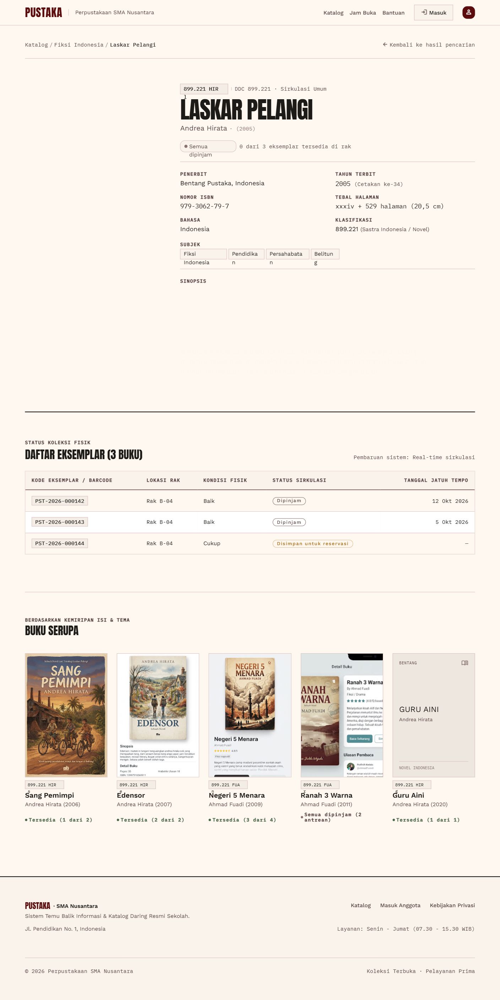

# Pustaka

Sistem manajemen perpustakaan untuk sekolah atau kampus (single-tenant): katalog, sirkulasi lewat scan barcode/QR, portal anggota (OPAC), reservasi, denda, laporan, dan pencarian semantik berbasis AI.



## Fitur

- **Katalog**: buku, eksemplar, barcode, sampul.
- **Sirkulasi**: peminjaman dan pengembalian dengan scan barcode/QR.
- **Portal anggota**: pinjaman aktif, reservasi, denda, kartu digital.
- **Denda & reservasi**: dihitung otomatis, dijalankan lewat job terjadwal.
- **Pencarian AI**: pencarian semantik (pgvector + embedding OpenRouter) digabung full-text lewat RRF.
- **Laporan** untuk staf.

## Tampilan

| Dasbor staf | Sirkulasi: pinjam |
| --- | --- |
|  |  |

| Portal anggota | Kartu digital |
| --- | --- |
|  |  |

| Hasil pencarian | Detail buku |
| --- | --- |
|  |  |

Arah desain "Pustaka Editorial": satu aksen oxblood, tanpa gradien, garis hairline. Lihat [docs/design/DESIGN.md](docs/design/DESIGN.md).

## Tech stack

| Lapisan | Teknologi |
| --- | --- |
| Frontend | Next.js 16 (App Router), React 19, Tailwind v4, shadcn/ui (base-nova), TanStack Query |
| Backend | NestJS 12 (ESM), Prisma 7, Zod 4, BullMQ |
| Data | PostgreSQL + pgvector, Redis |
| Infra | Docker, GitHub Actions, GHCR |

## Struktur

```
frontend/   Next.js (UI, bahasa Indonesia)
backend/    NestJS REST API di /api/v1
docker/     compose dev, compose produksi, Dockerfile
docs/       PRD, API, desain, deploy, daftar tugas
```

## Menjalankan (dev)

Prasyarat: Node.js, pnpm, Docker.

```bash
pnpm install:all
cp backend/.env.example backend/.env
cp frontend/.env.example frontend/.env.local

pnpm infra            # Postgres + pgvector, Redis, Mailpit (http://localhost:8025)
pnpm db:migrate
pnpm db:seed          # admin@pustaka.local / Admin12345 (ganti saat login pertama)

pnpm dev:backend      # http://localhost:3001/api/v1
pnpm dev:frontend     # http://localhost:3000
```

## Perintah lain

```bash
pnpm build       # build backend + frontend
pnpm lint
pnpm test        # unit test backend (Vitest)
pnpm test:e2e    # e2e backend (DB terpisah <db>_test)
```

## Deploy

Produksi memakai `docker/docker-compose.prod.yml` (salin `.env.example` ke `docker/.env`). Panduan: [Coolify](docs/deploy/coolify.md) dan [run pertama](docs/deploy/first-run.md).

## Dokumentasi

- [PRD](docs/project/PRD.md)
- [Referensi API](docs/api/README.md)
- [Desain](docs/design/README.md)
- Tugas: `docs/tasks/`
